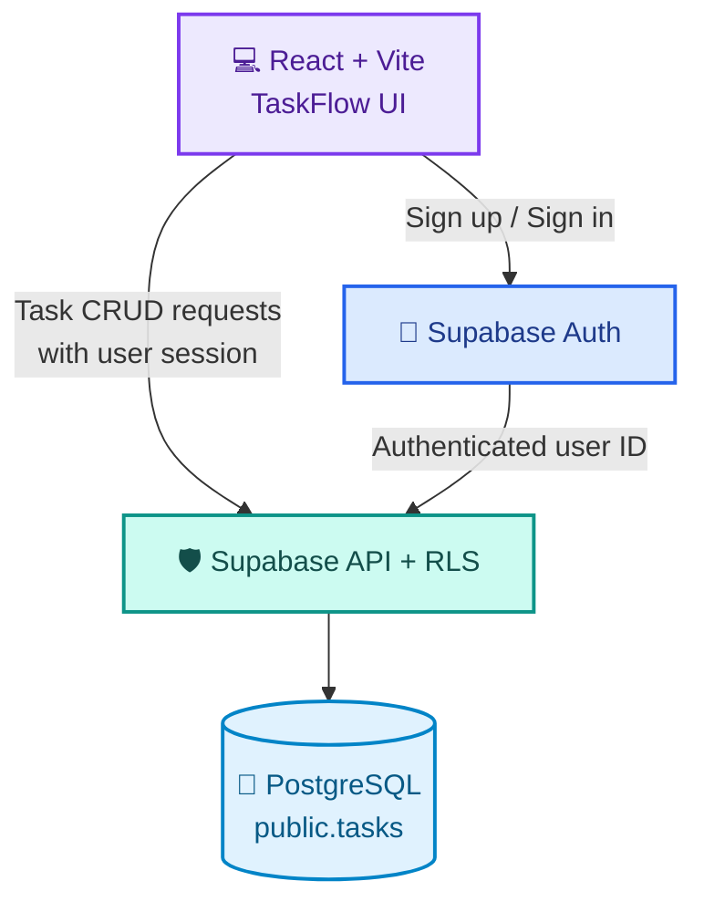

<div align="center">


### ✨ Your tasks. Your space. Your flow.

A modern, multi-user task manager built with **React** and **Supabase**.  
Private tasks, secure authentication, and cloud persistence — all in one focused workspace.

<p>
  
  
  
  
  
  
</p>

**[Features](#-features)** · **[Architecture](#-architecture)** · **[Quick start](#-quick-start)** · **[Security](#-security-first)** · **[Deployment](#-deploy-to-vercel)**

</div>

---

## 🌈 Overview

**TaskFlow SaaS** turns a simple to-do list into a personal, cloud-backed workspace. Create an account, manage your day, and come back to the same tasks after refreshing or signing in from another device.

> [!NOTE]
> This is a **multi-user MVP**, not a subscription or billing platform. Each account has its own tasks.

## 🚀 Features

| 🧩 Task management | 🔐 Account & privacy |
| :--- | :--- |
| ➕ Create, ✏️ edit, ✅ complete, and 🗑️ delete tasks | 📧 Email/password registration and login |
| 🎯 Priorities and 📅 deadlines | 🚪 Logout and persistent authentication session |
| 🔎 Search, filter, and track progress | ☁️ Tasks stored in PostgreSQL through Supabase |
| 📊 Counters and responsive dashboard | 🛡️ Database-level isolation with RLS |
| 📦 Optional import of old local tasks | 👤 Every task belongs to an authenticated user |

## 🏗️ Architecture



**How it works:** The React app sends authenticated requests to Supabase. PostgreSQL RLS policies decide which task rows the signed-in user can access. Client-side filters are for UX, **not** a security boundary.

## ⚡ Quick start

### 1. Create your Supabase project

1. Open the [Supabase Dashboard](https://supabase.com/dashboard) and create a project.
2. In **SQL Editor → New query**, run the full content of [`supabase/schema.sql`](supabase/schema.sql) on a **fresh** project.
3. In **Table Editor → tasks**, confirm the table exists and **RLS is enabled**.

The SQL sets up the task table, index, permissions, and **SELECT / INSERT / UPDATE / DELETE** policies. Supabase Auth manages the accounts in `auth.users`; this MVP does **not** require a custom users table.

### 2. Configure your environment

Copy the example file:

```bash
cp .env.example .env.local
```

On Windows PowerShell, use `Copy-Item .env.example .env.local` instead.

Edit `.env.local`:

```env
VITE_SUPABASE_URL=https://YOUR_PROJECT_REF.supabase.co
VITE_SUPABASE_PUBLISHABLE_KEY=sb_publishable_YOUR_PUBLIC_KEY
```

Find these values in **Supabase → Connect** or **Project Settings → API Keys**.

> [!IMPORTANT]
> Use the **publishable** key only. **Never** put a Supabase secret or `service_role` key in frontend environment variables. Vite exposes `VITE_` variables to the browser. Keep `.env.local` out of Git.

### 3. Run locally

Requires **Node.js 20.19+ or 22.12+**.

```bash
npm install
npm run dev
```

Open **http://localhost:5173**, select **Inscription**, and create your first account. If email confirmation is enabled in Supabase, confirm the email before logging in.

For local email redirects, set **Authentication → URL Configuration**:

| Setting | Development value |
| :--- | :--- |
| Site URL | `http://localhost:5173` |
| Additional Redirect URL | `http://localhost:5173/**` |

Email delivery can also be limited by Supabase's development email quota or SMTP settings.

## 🛡️ Security first

Tasks are private **because of PostgreSQL RLS**, not because the React UI hides other users' data.

| Action | Allowed when… |
| :--- | :--- |
| 📖 Read | The task's `user_id` matches the signed-in user |
| ➕ Create | The new task's `user_id` matches the signed-in user |
| ✏️ Update | The user owns the existing and resulting row |
| 🗑️ Delete | The user owns the task |

The policies are defined in [`supabase/schema.sql`](supabase/schema.sql), using `auth.uid()`.

### 🧪 Test account isolation

1. Register **Account A**, then create **Task A**.
2. Sign out and register **Account B**; create **Task B**.
3. Account B should see only Task B.
4. Sign back in as Account A; it should see only Task A.
5. Test creating, editing, completing, deleting, and refreshing tasks.

This is a useful functional check. For a production security audit, also test policy enforcement directly with **Supabase CLI / pgTAP**.

## 📦 Import tasks from the old version

Previously used the `localStorage`-only TaskFlow? You can migrate those tasks **if both versions run in the same browser and origin**.

1. Sign in to the new TaskFlow app.
2. Click **Importer dans mon compte** if the import option appears.
3. Review the imported tasks in your account.

The old storage entry is deleted **only after a successful insert**. Imports may include demo tasks, and repeating an import from other browsers may create duplicates. A different origin cannot read the original browser storage automatically.

## ▲ Deploy to Vercel

1. Push the project to GitHub — **exclude `.env.local`**.
2. Import the repository at **[vercel.com/new](https://vercel.com/new)**.
3. Use these build settings:

| Setting | Value |
| :--- | :--- |
| Framework | `Vite` |
| Build command | `npm run build` |
| Output directory | `dist` |
| Root directory | `./` |

4. Add `VITE_SUPABASE_URL` and `VITE_SUPABASE_PUBLISHABLE_KEY` in **Vercel → Project Settings → Environment Variables**.
5. Deploy (or redeploy after adding variables).
6. In **Supabase → Authentication → URL Configuration**, set **Site URL** to your production Vercel URL and add `https://your-app.vercel.app/**` (replace with your real domain) to **Redirect URLs**. Keep `http://localhost:5173/**` for local development.
7. Test **register → confirmation email (if required) → login → CRUD → refresh → logout** on the deployed site.

> [!TIP]
> An update to Vercel environment variables generally requires a new deployment for the Vite build to pick up the new values.

## 🗂️ Project structure

```text
taskflow-saas/
├── src/
│   ├── App.jsx            # Auth screens + task dashboard
│   ├── lib/
│   │   └── supabase.js     # Supabase browser client
│   └── styles.css         # Responsive UI + auth styles
├── supabase/
│   └── schema.sql         # Tasks table, grants & RLS policies
├── .env.example           # Safe variable template
├── .env.local             # Your local values (gitignored)
└── package.json
```

## 🧰 Troubleshooting

| Issue | Try this |
| :--- | :--- |
| **Configurer Supabase** screen | Check `.env.local` variable names; restart the dev server |
| `relation public.tasks does not exist` | Run `supabase/schema.sql` in the **correct** Supabase project |
| `permission denied for table tasks` | Verify SQL grants and RLS policies |
| `Email not confirmed` | Confirm your email and check the Auth URL configuration |
| `Failed to fetch` | Check the project URL, internet connection, and Supabase project status |
| Works locally, not on Vercel | Verify Production environment variables and redeploy |

---

<div align="center">

### 💜 Plan it. Do it. Own your flow.

Built with **React + Supabase** · Designed as a focused multi-user MVP.


</div>
